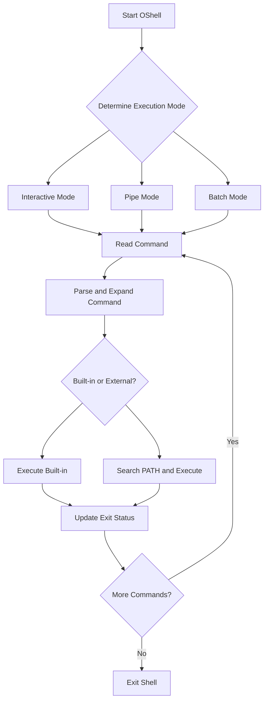

# OShell — A Simplified Unix Shell

A lightweight Unix command-line interpreter implemented in **C**, designed to demonstrate fundamental operating system concepts, including process management, command parsing, environment variables, file I/O, and signal handling.

OShell provides three execution modes, built-in commands, command chaining, variable expansion, output redirection, and external command execution while following common Unix shell conventions.

## 1. Project Overview

OShell is a simplified command-line shell that accepts and executes user commands in a Unix-like environment.

The project focuses on implementing core shell functionality from the ground up, including:

- Command parsing and execution.
- Process creation and management.
- Built-in command implementation.
- Environment variable management.
- External command execution and PATH searching.
- Input handling and signal management.
- File output redirection.
- Error handling and exit status management.

The shell supports interactive usage, standard input processing, and batch execution from files.

## 2. Key Features

### 2.1 Execution Modes

OShell supports three invocation modes:

- **Interactive Mode:** Displays a `$ ` prompt and accepts commands directly from the user. Uses `isatty()` to detect interactive input.
- **Pipe Mode:** Reads and executes commands from standard input without displaying an interactive prompt.
- **Batch Mode:** Reads and executes commands from a specified script file.

**Argument Validation:**
- Accepts zero or one command-line argument.
- Rejects additional arguments with an error.

### 2.2 Command Parsing and Operators

OShell supports the following command operators:

| Operator | Function | Description |
|---|---|---|
| `;` | Sequential Execution | Executes commands one after another. |
| `&&` | Conditional AND | Executes the next command only when the previous command succeeds. |
| `||` | Conditional OR | Executes the next command only when the previous command fails. |
| `&` | Parallel Execution | Executes commands concurrently and waits for all of them to finish. |
| `#` | Comments | Ignores the remainder of the command line. |
| `>` | Output Redirection | Redirects standard output and standard error to a file. |

The parser also supports flexible whitespace handling, allowing commands and operators to be written without requiring spaces around them.

Examples:

```bash
ls>output.txt
echo hello&&echo world
echo first;echo second
```

### 2.3 Built-in Commands

OShell implements seven built-in commands that execute directly within the shell process without creating separate processes through `fork()` and `exec()`.

| Command | Description |
|---|---|
| `exit [status]` | Exits the shell with an optional numeric status code. |
| `cd [dir]` | Changes the current working directory. |
| `env` | Displays environment variables. |
| `setenv NAME VALUE` | Creates or updates an environment variable. |
| `unsetenv NAME` | Removes an environment variable. |
| `alias` | Creates, displays, or manages command aliases. |
| `path` | Configures the shell's internal external-command search path. |

**Additional `cd` functionality:**
- Supports `-` for returning to the previous directory.
- Supports `--`.
- Supports `$HOME` and `$OLDPWD`.

### 2.4 Environment Variable Expansion

OShell supports variable expansion within commands.

| Syntax | Description |
|---|---|
| `$VAR` | Expands to the value of an environment variable. |
| `$?` | Expands to the exit status of the last executed command. |
| `$$` | Expands to the shell's process ID. |
| `$UNDEFINED` | Expands to an empty string when the variable is undefined. |

This provides basic environment variable functionality similar to common Unix shells.

### 2.5 External Command Execution and PATH Searching

OShell implements its own internal command search path.

Key behaviors include:

- Maintains an internal path list independent of the inherited `PATH` environment variable.
- Uses `/bin` as the default search directory.
- Searches executable locations using `access(path, X_OK)`.
- Supports absolute paths, such as `/usr/bin/ls`.
- Supports relative paths, such as `./program`.
- Executes external programs through process creation and execution mechanisms.

**Command Execution Exit Codes:**

| Exit Code | Meaning |
|---|---|
| `126` | Command was found but could not be executed. |
| `127` | Command was not found. |

### 2.6 Exit Status Management

OShell manages and returns command execution status.

- Maintains the exit status of executed commands.
- Returns `0` for successful operations.
- Returns non-zero values for failed operations.
- Built-in commands return appropriate status codes.
- Supports `$?` for accessing the previous command's exit status.

### 2.7 Error Handling

The shell implements centralized error handling.

- Uses the unified error message: `An error has occurred`.
- Continues execution after most command errors.
- Exits with status `1` when a batch file cannot be opened.
- Rejects invalid argument counts during startup.

### 2.8 Signal Handling

OShell handles basic terminal signals:

- **Ctrl+C (SIGINT):** Ignored at the interactive prompt so the shell continues running.
- **Ctrl+D (EOF):** Exits the shell through end-of-file handling.

### 2.9 Whitespace Handling

The command parser supports flexible spacing:

- Allows arbitrary spaces and tabs around commands.
- Recognizes operators without requiring surrounding spaces.
- Handles commands with different whitespace arrangements.

### 2.10 Manual Pages

The project includes documentation through Unix manual pages for its built-in commands and shell functionality.

Nine manual pages are provided:

- `oshell.1` — Main shell documentation.
- `builtins.1` — Overview of built-in commands.
- `exit.1`
- `cd.1`
- `env.1`
- `setenv.1`
- `unsetenv.1`
- `alias.1`
- `path.1`

## 3. Technical Implementation

OShell is implemented in C using Unix system programming concepts.

### Core Technologies

| Technology | Purpose |
|---|---|
| C | Core programming language |
| GCC | Compilation |
| Make | Build automation |
| Unix System Calls | Process and file management |
| POSIX APIs | Terminal handling and signal management |
| Man Pages | Command-line documentation |

### Core Operating System Concepts

**Process Management**
- Creating child processes.
- Executing external programs.
- Managing concurrent command execution.
- Waiting for child processes.

**Command Processing**
- Parsing command strings.
- Recognizing shell operators.
- Expanding environment variables.
- Resolving and executing commands.

**File Management**
- File creation and output redirection.
- Managing standard output and standard error.
- Handling input from standard input and batch files.

**Signal Management**
- Handling terminal signals.
- Managing end-of-file conditions.
- Maintaining shell behavior during interactive execution.

### Application Workflow



## 4. Project Structure

```text
oshell/
│
├── README.md
├── Makefile
│
├── man/
│   ├── alias.1
│   ├── builtins.1
│   ├── cd.1
│   ├── env.1
│   ├── exit.1
│   ├── oshell.1
│   ├── path.1
│   ├── setenv.1
│   └── unsetenv.1
│
├── src/
│   ├── main.c
│   │
│   ├── include/
│   │   ├── errors.h
│   │   ├── shell.h
│   │   └── utils.h
│   │
│   ├── core/
│   │   ├── builtins.c
│   │   ├── errors.c
│   │   ├── executor.c
│   │   ├── expander.c
│   │   ├── parser.c
│   │   ├── state.c
│   │   └── utils.c
│   │
│   └── modes/
│       ├── batch.c
│       ├── determine.c
│       ├── interactive.c
│       ├── pipe.c
│       └── modes.h
│
└── oshell
```

## 5. Compilation and Installation

### Prerequisites

- Unix-like operating system.
- GCC compiler.
- GNU Make.

### Method 1: Using Makefile

Clone the repository:

```bash
git clone <repository-url>
cd oshell
```

Clean previous build files and compile:

```bash
make clean
make
```

### Method 2: Manual Compilation

Alternatively, compile the source files directly:

```bash
gcc -Wall -Wextra -Werror -Isrc/include \
src/main.c \
src/core/builtins.c \
src/core/errors.c \
src/core/executor.c \
src/core/expander.c \
src/core/parser.c \
src/core/state.c \
src/core/utils.c \
src/modes/batch.c \
src/modes/determine.c \
src/modes/interactive.c \
src/modes/pipe.c \
-o oshell
```

Successful compilation produces the `oshell` executable.

## 6. Running OShell

### 6.1 Interactive Mode

Start the shell:

```bash
./oshell
```

Example:

```bash
$ echo Hello World
Hello World
$ pwd
/home/user
$ exit
```

### 6.2 Pipe Mode

Pass commands through standard input:

```bash
echo "echo hello" | ./oshell
```

### 6.3 Batch Mode

Execute commands from a script file:

```bash
./oshell script.txt
```

## 7. Testing Examples

The following examples demonstrate the supported shell functionality.

### 7.1 Command Operators

**Sequential execution:**

```bash
echo first ; echo second
```

**Conditional AND:**

```bash
echo a && echo b
```

**Conditional OR:**

```bash
cat /nonexistent || echo "Error handled"
```

**Parallel execution:**

```bash
sleep 1 & echo "Immediate"
```

**Comments:**

```bash
echo visible # invisible
```

**Output redirection:**

```bash
ls -la > output.txt
```

### 7.2 Built-in Commands

```bash
cd /tmp && pwd
env
setenv TESTVAR value
unsetenv TESTVAR
alias ll='ls -l'
path /bin /usr/bin
exit 0
```

### 7.3 Variable Expansion

```bash
echo "$HOME"
echo "$$"
echo "$?"
```

## 8. Current Limitations

OShell implements a simplified subset of Unix shell functionality. The following features are not currently supported:

- **Pipe Operator (`|`):** Does not support connecting the output of one command to another command's input.
- **Input Redirection (`<`):** Does not support redirecting input from a file.
- **Append Redirection (`>>`):** Does not support appending output to an existing file.
- **Command Substitution:** Does not support `$(command)` or backtick substitution.
- **Job Control:** Does not implement commands and functionality such as `jobs`, `fg`, and `bg`.

## 9. Learning Outcomes

This project demonstrates practical understanding of fundamental operating system and systems programming concepts:

- Process creation and execution using `fork()` and `exec()` mechanisms.
- Child process synchronization using `wait()` mechanisms.
- Command parsing and execution architecture.
- Environment variable management.
- File descriptors and output redirection.
- Signal handling and terminal behavior.
- System-level error handling.
- Dynamic memory management in C.
- Modular systems programming and project organization.

## 10. Attribution and Acknowledgments

This project was developed for educational purposes as part of an Operating Systems course.

All code presented in this project is the original work of **Tesfamichael Assefa**.

Special thanks to **Mr. Abebayehu** for providing the project specification, technical guidance, and support throughout the development process.

---

**Author:** Tesfamichael Assefa  
**Student ID:** 3630/16  
**Project:** OShell — A Simplified Unix Shell  
**Course:** Operating Systems  
**Completion:** December 2025  
**Version:** 1.0

**Developed using C and Unix system programming concepts.**
